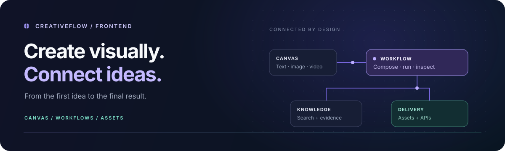
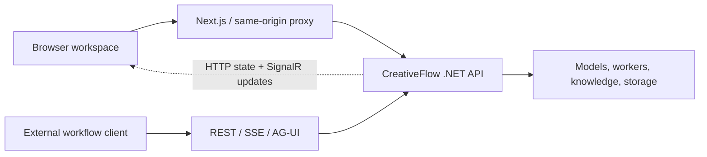

<div align="center">



# CreativeFlow Frontend

**Create on a canvas. Compose with intent. See every step.**

The visual workspace for CreativeFlow: media creation, general orchestration, knowledge, assets, and administration.

[](package.json)
[](package.json)
[](tsconfig.json)
[](https://github.com/233i/creativeflow-frontend/actions/workflows/frontend.yml)
[](LICENSE)

[Quick start](#quick-start) · [Workspace](#your-workspace-at-a-glance) · [Development](#built-for-maintainable-interfaces) · [Documentation](docs/README.md) · [Backend ↗](https://github.com/233i/creativeflow-backend)

**English** · [简体中文](README.zh-CN.md)

</div>

---

## Your workspace at a glance

CreativeFlow brings creative work and business automation into one workspace—while keeping their editors distinct. Build a media pipeline, assemble a knowledge-backed workflow, and inspect its execution without losing the context of the graph.

| Workspace                     | What you can do                                                                                                                    |
| ----------------------------- | ---------------------------------------------------------------------------------------------------------------------------------- |
| **AI canvas**                 | Arrange prompts and media, generate images/videos, and reuse uploaded or generated assets                                          |
| **Media workflows**           | Connect reference images, image/video generation, video extension, frame extraction, and outputs                                   |
| **General orchestration**     | Wire typed inputs through LLMs, knowledge retrieval, extraction, routing, transformations, HTTP tools, scripts, loops, and batches |
| **Execution and publication** | Inspect node progress and model calls, debug individual nodes, review history, and publish fixed API versions                      |
| **Knowledge and assets**      | Preview document chunks, manage index versions, test retrieval, reuse assets, and inspect lifecycle/reference constraints          |
| **Administration**            | Manage model channels, enabled selections, credentials, API access, templates, users, and run records                              |

Available nodes and actions depend on backend capabilities, permissions, and model configuration. This is the actual web client, **not a standalone backend or an offline mock application**.

## Different work, different editors

|            | Media creation                                     | General orchestration                                                     |
| ---------- | -------------------------------------------------- | ------------------------------------------------------------------------- |
| Start with | Prompts, local images, or assets from the library  | Published input fields: text, structured data, or authorized image assets |
| Compose    | Image/video generation and media transformations   | Models, data processing, knowledge, branches, loops, batches, and tools   |
| Inspect    | Media previews, generation state, reusable results | Node execution, typed outputs, model-call records, and citations          |
| Publish    | A versioned media workflow API                     | A versioned orchestration API                                             |

Both editors share the workflow center and lifecycle controls. They do not collapse into one overloaded node system. The free-form canvas remains a separate creative surface.

### Build → inspect → recover → publish

1. **Build with context.** Configure nodes and connect their data/control ports; choose from backend-managed models and authorized resources.
2. **Inspect the run.** See execution states in the graph and details panel, inspect model calls, and revisit saved run history.
3. **Recover deliberately.** Query the existing run or use permitted retry/skip/checkpoint operations. A query does not start another generation; rollback does not undo external side effects.
4. **Publish a fixed version.** Review the input/output contract, grant access, and use generated REST, SSE, or AG-UI integration examples.

> Long-running work belongs to the backend. Closing a panel or browser page does not cancel a submitted workflow; UI refreshes recover persisted state.

## Quick start

### 1. Start the companion API

Follow the backend's [local quick start](https://github.com/233i/creativeflow-backend/blob/main/README.md#quick-start-isolated-local-api). Confirm:

```bash
curl -fsS http://localhost:5298/health/ready
```

Set the backend `Authentication:PublicOrigin` to `http://localhost:3000` (Compose variable: `PUBLIC_ORIGIN`). Restart/recreate the API after changing it. The backend supplies authentication, models, queues, knowledge, storage, and migrations.

### 2. Start the web application

Install the Node version pinned in [.node-version](.node-version), then use a fresh checkout:

```bash
git clone https://github.com/233i/creativeflow-frontend.git
cd creativeflow-frontend
npm ci
cp .env.example .env.development.local
npm run dev
```

The example environment targets the API on port 5298 and the web app on port 3000:

```dotenv
API_BASE_URL=http://localhost:5298
SOL_API_ORIGIN=http://localhost:5298
NEXT_PUBLIC_SITE_URL=http://localhost:3000
```

Keep `SOL_API_ORIGIN` as written: it is the current configuration key. Check existing shell/local overrides before replacing configuration; do not mix `localhost` and `127.0.0.1` during login.

### 3. Explore and verify

| Open                                                     | Purpose                                                                          |
| -------------------------------------------------------- | -------------------------------------------------------------------------------- |
| [Administration](http://localhost:3000/admin)            | Sign in with the backend bootstrap administrator and change the initial password |
| [Workflow center](http://localhost:3000/admin/workflows) | Create, import, manage, and publish workflows                                    |
| [Run center](http://localhost:3000/admin/runs)           | Inspect workflow execution records                                               |
| [User canvas](http://localhost:3000/)                    | Register a separate ordinary account and start a canvas                          |

Import the backend's [startup-echo.workflow.json](https://github.com/233i/creativeflow-backend/blob/main/docs/examples/startup-echo.workflow.json). With `message = Hello CreativeFlow`, **Start → End** should return `result = Hello CreativeFlow` without a model call.

Then upload a test image, select it from the asset library, save, and refresh. Follow [local acceptance](docs/local-development.md#不调用模型的验收) for persistence checks. Configure providers/models before generation; knowledge and script execution additionally need their backend services.

## How the application connects



The browser uses same-origin `/api` and `/hubs/creativeflow`. Swagger and health endpoints are accessed on the API port. Production needs a reverse proxy with WebSocket support and unbuffered SSE; model credentials stay on the backend, never in `NEXT_PUBLIC_*`.

## Built for maintainable interfaces

**Next.js App Router · React · TypeScript · React Flow · Zustand · Tailwind CSS · TDesign**

```text
app/                              App Router pages and layouts
features/
├── canvas/                       Free-form canvas and media interaction
├── workflow/                     Media and orchestration editors
├── admin/                        Workflow center and administration
├── ai/                           Shared model catalog and selection
└── assets/                       Asset management
components/                       Shared UI, layout, and providers
lib/                              Shared clients and utilities
e2e/                              Cross-service browser checks
```

Domain rules, state/controllers, API adapters, and presentation have separate responsibilities. The node registry defines typed ports and capabilities; frontend boundaries and complexity checks guard the module structure. See [maintenance](docs/frontend-maintenance.md).

| Command            | What it checks or runs                                                   |
| ------------------ | ------------------------------------------------------------------------ |
| `npm run dev`      | Local development server                                                 |
| `npm run check`    | Formatting, zero-warning lint, boundaries, complexity, types, unit tests |
| `npm run verify`   | All checks plus a production build                                       |
| `npm test`         | Vitest regression suite                                                  |
| `npm run test:e2e` | Playwright checks against an isolated test API                           |

The CI badge links to actual Actions results, not a hard-coded success claim. `verify` does not validate every provider or backend integration. The browser CI job is skipped when its dedicated API is not configured; see [verification limits](docs/frontend-maintenance.md#已知检查限制).

## Deploy with the backend in mind

The app builds with `output: "standalone"`. Use the [deployment guide](docs/deployment.md) for the Node server or Docker image, static assets, HTTPS, WebSocket, and SSE proxying.

- Provide API rewrite and `NEXT_PUBLIC_*` values **at build time**; changing only runtime environment variables cannot rewrite the built client.
- Never place model keys, administrator passwords, uploads, or traces in the repository.
- Keep npm and Bun lockfiles in sync when changing dependencies: local verification uses npm; the Dockerfile uses Bun.
- Test with independent synthetic accounts and assets, not production resources.

| You want to…                                    | Read                                                                                                                                                                                           |
| ----------------------------------------------- | ---------------------------------------------------------------------------------------------------------------------------------------------------------------------------------------------- |
| Configure local addresses or troubleshoot login | [Local development](docs/local-development.md)                                                                                                                                                 |
| Deploy the web app                              | [Deployment](docs/deployment.md)                                                                                                                                                               |
| Add nodes, adapters, or admin forms             | [Frontend maintenance](docs/frontend-maintenance.md)                                                                                                                                           |
| Integrate a published workflow                  | [REST/SSE](https://github.com/233i/creativeflow-backend/blob/main/docs/workflow-api-streaming.md) · [AG-UI](https://github.com/233i/creativeflow-backend/blob/main/docs/ag-ui-workflow-api.md) |
| Understand server-side permissions and limits   | [Backend documentation](https://github.com/233i/creativeflow-backend/blob/main/docs/README.md)                                                                                                 |

## License and attribution

CreativeFlow is derived from [AIDotNet/Sol](https://github.com/AIDotNet/Sol), including its browser application. The upstream **MIT License** and `Copyright (c) 2026 AIDotNet` notice are preserved in [LICENSE](LICENSE).

This attribution does not imply upstream maintenance or endorsement. Third-party dependencies and provider marks retain their respective licenses and rights.
