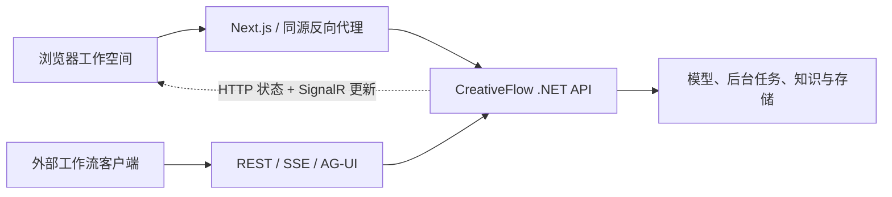

<div align="center">


# CreativeFlow 前端

**在画布上创作，用工作流连接，让每一步执行清晰可见。**

CreativeFlow 的可视化工作空间，连接媒体创作、通用编排、知识库、资产与管理后台。

[](package.json)
[](package.json)
[](tsconfig.json)
[](https://github.com/233i/creativeflow-frontend/actions/workflows/frontend.yml)
[](LICENSE)

[快速开始](#快速开始) · [工作空间](#一个工作空间连接创作与业务) · [开发维护](#面向维护的前端结构) · [文档中心](docs/README.md) · [后端仓库 ↗](https://github.com/233i/creativeflow-backend)

[English](README.md) · **简体中文**

</div>

---

## 一个工作空间，连接创作与业务

CreativeFlow 将创作与业务自动化放在同一个工作空间中，同时保留各自专业的编辑器。搭建媒体生产流程、组合知识问答链路，再回到图上查看每一步执行结果。

| 工作区域       | 可以做什么                                                                           |
| -------------- | ------------------------------------------------------------------------------------ |
| **AI 画布**    | 组织提示词与媒体，生成图片/视频，复用上传或生成的素材                                |
| **媒体工作流** | 连接参考图、生图、生视频、视频延长、抽帧与结果节点                                   |
| **通用编排**   | 将类型化输入连接到 LLM、知识检索、参数提取、意图路由、转换、HTTP、脚本、循环与批处理 |
| **执行与发布** | 查看节点进度与模型调用，单节点调试，回看运行历史，发布固定 API 版本                  |
| **知识与资产** | 预览文档切片、管理索引版本、测试检索、复用素材，查看生命周期与引用约束               |
| **管理后台**   | 管理模型渠道、可选模型、凭据、API 访问、模板、用户与运行记录                         |

节点和操作是否可用，取决于后端能力、权限及模型配置。本仓库是完整系统的网页客户端，**不是独立后端，也不是离线模拟应用**。

## 不同任务，使用不同编辑器

|            | 媒体创作                       | 通用编排                                       |
| ---------- | ------------------------------ | ---------------------------------------------- |
| 从哪里开始 | 提示词、本地图片或素材库资源   | 声明文本、结构化数据或已授权图片输入           |
| 如何组合   | 图片/视频生成与媒体处理        | 模型、数据处理、知识、条件、循环、批处理与工具 |
| 查看什么   | 媒体预览、生成状态、可复用结果 | 节点执行、类型化输出、模型调用记录与引用       |
| 如何发布   | 版本化媒体工作流 API           | 版本化通用编排 API                             |

两种编辑器共享工作流中心与生命周期管理，不合并为一套拥挤的节点系统。自由画布仍然是独立的创作入口。

### 编排 → 观察 → 恢复 → 发布

1. **配置与连线。** 编辑节点、连接数据与执行端口，选择后台配置的模型和已授权资源。
2. **观察运行。** 在画布及详情面板查看节点状态、模型调用与输出，重新打开历史运行。
3. **明确恢复操作。** 查询原运行，或使用当前状态允许的重试、跳过、检查点重跑。查询不会重新生成；回滚不会撤销外部副作用。
4. **发布固定版本。** 检查输入输出契约、配置访问授权，使用自动生成的 REST、SSE 或 AG-UI 接入示例。

> 长任务由后端持续执行。关闭面板或浏览器不会取消已提交工作流，重新打开时从持久化状态恢复展示。

## 快速开始

### 1. 先启动配套后端

按后端的[本机快速启动](https://github.com/233i/creativeflow-backend/blob/main/README.zh-CN.md#快速开始本机独立环境)准备独立环境，确认：

```bash
curl -fsS http://localhost:5298/health/ready
```

后端 `Authentication:PublicOrigin` 设置为 `http://localhost:3000`（Compose 变量为 `PUBLIC_ORIGIN`），修改后重启或重新创建 API。鉴权、模型、队列、知识库、存储与迁移由后端负责。

### 2. 启动网页

先安装 [.node-version](.node-version) 固定的 Node 版本，再使用新克隆目录执行：

```bash
git clone https://github.com/233i/creativeflow-frontend.git
cd creativeflow-frontend
npm ci
cp .env.example .env.development.local
npm run dev
```

环境示例指向 5298 端口的本机 API，以及 3000 端口的网页：

```dotenv
API_BASE_URL=http://localhost:5298
SOL_API_ORIGIN=http://localhost:5298
NEXT_PUBLIC_SITE_URL=http://localhost:3000
```

`SOL_API_ORIGIN` 是当前代码使用的配置键，不要自行改名。已有 shell 或本机配置时先核对优先级，不直接覆盖；登录过程中不要混用 `localhost` 与 `127.0.0.1`。

### 3. 打开页面并验证

| 入口                                                | 用途                                     |
| --------------------------------------------------- | ---------------------------------------- |
| [管理后台](http://localhost:3000/admin)             | 使用后端引导管理员登录，然后修改初始密码 |
| [工作流中心](http://localhost:3000/admin/workflows) | 新建、导入、管理和发布工作流             |
| [运行中心](http://localhost:3000/admin/runs)        | 查看工作流执行记录                       |
| [用户画布](http://localhost:3000/)                  | 单独注册普通账号，开始创作               |

导入后端的 [startup-echo.workflow.json](https://github.com/233i/creativeflow-backend/blob/main/docs/examples/startup-echo.workflow.json)，输入 `message = Hello CreativeFlow`，**开始 → 结束** 应输出相同的 `result`，不调用模型。

然后上传测试图片、从素材库选择、保存并刷新，按[本地验收说明](docs/local-development.md#不调用模型的验收)验证持久化。真实生成前配置模型；知识库和脚本执行还需要对应后端服务。

## 网页如何连接后端



浏览器通过同源 `/api` 与 `/hubs/creativeflow` 访问服务；Swagger 和健康检查使用后端端口。生产代理需要支持 WebSocket 与不缓冲的 SSE。模型密钥始终留在后端，不能写入 `NEXT_PUBLIC_*`。

## 面向维护的前端结构

**Next.js App Router · React · TypeScript · React Flow · Zustand · Tailwind CSS · TDesign**

```text
app/                              App Router 页面与布局
features/
├── canvas/                       自由画布与媒体交互
├── workflow/                     媒体和通用编排编辑器
├── admin/                        工作流中心与后台管理
├── ai/                           共享模型目录与选择
└── assets/                       资产管理
components/                       通用 UI、布局与上下文
lib/                              共享客户端与工具
e2e/                              跨服务浏览器检查
```

领域规则、状态与控制器、API 适配器、展示组件分离；节点注册表定义类型化端口与能力，通过模块依赖边界和复杂度检查约束结构。详见[维护说明](docs/frontend-maintenance.md)。

| 命令               | 用途                                                |
| ------------------ | --------------------------------------------------- |
| `npm run dev`      | 启动本地开发服务                                    |
| `npm run check`    | 格式、零警告 lint、依赖边界、复杂度、类型与单元测试 |
| `npm run verify`   | 完整检查加生产构建                                  |
| `npm test`         | Vitest 回归测试                                     |
| `npm run test:e2e` | 连接独立测试 API 的 Playwright 验收                 |

CI 徽章指向真实 Actions 结果，不写死“全部通过”。`verify` 不代表所有模型及后端联调已通过。未配置独立测试 API 时，浏览器 CI 作业会跳过，详见[验证边界](docs/frontend-maintenance.md#已知检查限制)。

## 与后端一起规划部署

项目使用 `output: "standalone"`。Node 服务、Docker 镜像、静态资源、HTTPS、WebSocket 与 SSE 代理请按[部署指南](docs/deployment.md)配置。

- API rewrite 和 `NEXT_PUBLIC_*` 必须在**构建时**提供，只改运行时环境变量无法修改已构建客户端。
- 不把模型密钥、管理员密码、上传文件或调试 trace 放进仓库。
- 依赖变更同时更新 npm 与 Bun 锁文件：本机验证使用 npm，Dockerfile 使用 Bun。
- 测试使用独立环境和合成账号、素材，不连接生产资源。

| 接下来要做什么                 | 文档                                                                                                                                                                                           |
| ------------------------------ | ---------------------------------------------------------------------------------------------------------------------------------------------------------------------------------------------- |
| 配置本机地址、排查登录         | [本地开发](docs/local-development.md)                                                                                                                                                          |
| 发布网页                       | [部署指南](docs/deployment.md)                                                                                                                                                                 |
| 新增节点、API 适配器或后台表单 | [前端维护](docs/frontend-maintenance.md)                                                                                                                                                       |
| 接入已发布工作流               | [REST/SSE](https://github.com/233i/creativeflow-backend/blob/main/docs/workflow-api-streaming.md) · [AG-UI](https://github.com/233i/creativeflow-backend/blob/main/docs/ag-ui-workflow-api.md) |
| 了解服务端权限与能力限制       | [后端文档](https://github.com/233i/creativeflow-backend/blob/main/docs/README.md)                                                                                                              |

## 许可证与致谢

CreativeFlow 基于 [AIDotNet/Sol](https://github.com/AIDotNet/Sol)（含其浏览器应用）二次开发，上游 **MIT License** 及 `Copyright (c) 2026 AIDotNet` 声明完整保留于 [LICENSE](LICENSE)。

该说明不代表上游维护或认可 CreativeFlow。第三方依赖与服务商标识遵循各自的许可和权利声明。
